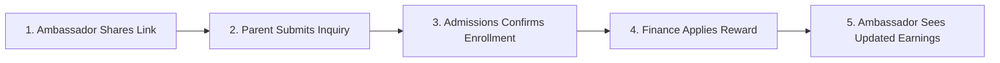

# Heguru Partnership Program (HPP) — User & Manager Testing Guide

**Document Purpose:** Non-Technical Product & Testing Manual  
**Target Audience:** Project Managers, Business Executives, and QA Reviewers  
**System Name:** Heguru Partnership Application (5-Star Ambassador Program)  
**Version:** 1.0 (Production-Ready)

---

## 1. What is the Heguru Partnership Program?

The **Heguru Partnership Program (HPP)** is an online platform created for Heguru’s 25th-year celebration. It turns parents, teachers, and alumni into brand ambassadors who can refer friends and family to Heguru centers.

### How Rewards Work (In Simple Terms)
When an ambassador refers a new student who enrolls in Heguru:
1. **Parents with children in Heguru:** The reward is automatically credited as a **Fee Discount / Fee Waiver** towards their child’s tuition fee.
2. **Staff, Alumni, or Community Members:** The reward is paid out as a **Direct Bank Transfer / Cash Reward**.
3. **One Confirmed Referral Rule:** Making just **1 confirmed referral per year** keeps all program benefits active.

---

## 2. Who Uses the System? (User Roles Explained)

| Role | Who They Are | What They Can Do |
| :--- | :--- | :--- |
| **Super Admin** | School Executives & IT Directors | Has complete master control. Can view all school branches, manage users, set incentive rules, approve payments, and run WhatsApp/Email campaigns. |
| **Campus Head** | Branch Principals & Center Managers | Manages their specific school branch. Monitors monthly branch admission targets, tracks local leads, and views campus reports. |
| **Admission Admin** | Central Admissions Team | Reviews incoming student leads, contacts prospective parents, confirms official admissions, and verifies student enrollment details. |
| **Finance Admin** | Finance & Accounts Team | Manages ambassador payout requests, calculates tuition fee waivers, processes bank transfers with UTR numbers, and handles registration fee refunds. |
| **Ambassadors** *(Parents & Staff)* | Parents, Teachers, Alumni & Champions | Gets a personalized referral link to share via WhatsApp, tracks referred leads in real-time, views earned rewards, and raises support tickets. |

---

## 3. Verified Working Test Credentials

Use these verified demo accounts to test each role. All test accounts share the same default password.

| Role / Profile | Mobile Number | Password | What to Expect After Login |
| :--- | :--- | :--- | :--- |
| **Super Admin** | `9999999999` | `123456` | Lands on the **Super Admin Master Dashboard** with complete school-wide metrics and settings. |
| **Campus Head** | `8888888888` | `123456` | Lands on the **Campus Portal** showing branch targets, local student counts, and branch activities. |
| **Admission Admin** | `7777777777` | `123456` | Lands on the **Admissions Desk** to review and confirm pending student referral leads. |
| **Finance Admin** | `6666666666` | `123456` | Lands on the **Finance & Settlements Portal** to process cash payouts and fee waivers. |
| **Parent Ambassador** *(Vikram Rathore)* | `9100000001` | `123456` | Lands on the **Ambassador Dashboard** with personal referral code `ACH25-P1` and fee discount tracker. |
| **Staff Ambassador** *(Suresh Chandran)* | `9000000001` | `123456` | Lands on the **Staff Ambassador Dashboard** with personal referral code `ACH25-S1` and cash payout tracker. |

> [!TIP]
> **How Login Works:**  
> 1. Go to the home page (`http://localhost:3001` or your portal address).  
> 2. Enter any mobile number from the table above and click **Continue**.  
> 3. Enter password `123456` and click **Login**.  
> 4. You will be automatically redirected to your role’s specific home screen.

---

## 4. Key Sections of the Application

### 4.1 Ambassador Portal (`/dashboard`)
*Accessible by: Parents, Staff, Alumni*
- **Personal Referral Link:** A short, unique link (e.g., `/r/...`) that ambassadors can copy or share directly to WhatsApp with pre-written invitation messages.
- **My Referrals (`/referrals`):**
  - **In Progress:** Prospective parents who were invited but haven't enrolled yet. Includes a **WhatsApp Nudge** button to remind them.
  - **Confirmed:** Leads who have officially joined Heguru, showing the exact reward secured.
- **My Earnings (`/earnings`):** Shows tuition discounts applied or bank payout history.
- **Support Desk (`/support`):** Allows ambassadors to submit questions or report issues, chat with staff, and give a 1-to-5 star rating once resolved.

---

### 4.2 Public Referral Form (`/refer`)
*Accessible by: Anyone with a referral link*
- When a parent clicks an ambassador's link, they see a welcome message: *"Referred by [Ambassador Name]"*.
- Parents fill out simple details: Child’s Name, Selected Heguru Branch, and Grade.
- **Offline Support:** If a parent submits while in an area with poor internet connection, the app safely saves the lead and automatically sends it once internet is restored.

---

### 4.3 Admissions Management Desk (`/admin`)
*Accessible by: Admission Admins*
- **Referral Pipeline:** Shows every parent inquiry submitted through ambassador links.
- **Confirm Admission:** When a parent pays the school admission fee, the admissions officer enters the student's admission number and clicks **Confirm**. This automatically rewards the ambassador.
- **Disqualify / Reject:** If an inquiry was invalid or a duplicate, officers can record a reason and reject it cleanly.

---

### 4.4 Finance & Settlements Portal (`/finance`)
*Accessible by: Finance Admins*
- **Registrations & Refunds:** Tracks all ₹25 registration fees paid during onboarding. Highlights ambassadors eligible for a full refund after achieving their first confirmed referral.
- **Tuition Fee Waivers (Group A):** Lists parents whose referral rewards will be deducted from their child’s next term tuition fee.
- **Direct Bank Payouts (Group B):** Lists staff and alumni due for bank transfers. Finance officers enter bank transaction UTR numbers to mark them paid.

---

### 4.5 Campus Head Portal (`/campus`)
*Accessible by: Campus Heads & Branch Admins*
- **Branch Target Bar:** Shows monthly admission targets vs. actual enrollments for the branch.
- **Daily War Room:** A live branch leaderboard showing which Heguru center is leading in admissions this week.
- **Branch Directory:** Quick search of students and ambassadors registered at this specific campus.

---

### 4.6 Super Admin Control Room (`/superadmin`)
*Accessible by: Super Admin only*
- **Master Analytics:** School-wide student enrollment counts, total conversion rate, and total reward liabilities.
- **Campaign Studio:** Create and broadcast announcements via WhatsApp, SMS, or Email to specific campuses or user groups.
- **Payment Verification Queue (`/superadmin/approvals`):** Review and approve manual UPI/QR code payment receipts submitted during registration.
- **Child Verification (`/superadmin/verification`):** Match staff and parent children against official student records to activate tuition benefits.

---

## 5. Quick Step-by-Step Test Scenarios

Follow these 5 simple tests to verify the system from start to finish:

---

### Test 1: Log in as a Parent & Share a Referral Link
1. Go to the login screen.
2. Enter mobile `9100000001` and password `123456`.
3. Verify you land on the **Ambassador Dashboard** for *Vikram Rathore*.
4. Look for the referral card showing code `ACH25-P1`.
5. Click **Copy Link** (or click the green **Share on WhatsApp** button).
6. **Pass Criteria:** The link copies cleanly in the format `.../r/[code]`.

---

### Test 2: Submit a Referral as a New Parent
1. Open a new Incognito browser window.
2. Paste the copied referral link into the address bar.
3. Verify you see the gold header saying: *"Referred by Vikram Rathore"*.
4. Enter parent mobile number (e.g. `9876500001`), select campus **ASM-VILLIANUR**, choose grade **PRIMARY**, and submit.
5. **Pass Criteria:** A success screen confirms the referral was registered.

---

### Test 3: Confirm the Admission as Admissions Officer
1. Open a normal browser window and log in as Admission Admin using mobile `7777777777` and password `123456`.
2. Go to **Referral Pipeline** (`/admin?view=referrals`).
3. Find the lead submitted in Test 2.
4. Click **Confirm Admission**. Enter Admission No: `HEG-2026-001` and select Fee Type: `OTP`.
5. Click **Submit**.
6. **Pass Criteria:** The lead status changes to **Confirmed** (green tag).

---

### Test 4: Check Rewards as Finance Admin
1. Log in as Finance Admin using mobile `6666666666` and password `123456`.
2. Go to the **Finance & Settlements** page (`/finance`).
3. Click on the **Waivers & Liabilities** tab.
4. Verify that *Vikram Rathore* appears in the fee waiver list with his earned discount calculated.
5. **Pass Criteria:** The reward is calculated and ready for fee credit.

---

### Test 5: Verify Role Protection & Security
1. Log in as Parent Ambassador using `9100000001` and password `123456`.
2. In the browser address bar, try manually typing: `http://localhost:3001/superadmin` or `/finance`.
3. Press Enter.
4. **Pass Criteria:** The system blocks access immediately and bounces you back to your regular `/dashboard`. A parent cannot see financial or administrative screens.

---

## 6. Summary Quick-Reference Card

| What You Want to Test | Who to Log In As | Mobile Number | Password | Where to Go |
| :--- | :--- | :--- | :--- | :--- |
| **Share Link & View Rewards** | Parent Ambassador | `9100000001` | `123456` | `/dashboard` |
| **Share Link & Cash Payouts** | Staff Ambassador | `9000000001` | `123456` | `/dashboard` |
| **Review & Confirm Inquiries** | Admission Admin | `7777777777` | `123456` | `/admin` |
| **Process Payouts & Waivers** | Finance Admin | `6666666666` | `123456` | `/finance` |
| **Check Campus Targets** | Campus Head | `8888888888` | `123456` | `/campus` |
| **Full System Control** | Super Admin | `9999999999` | `123456` | `/superadmin` |

---
*Testing guide prepared for executive evaluation of the Heguru Partnership Application.*
